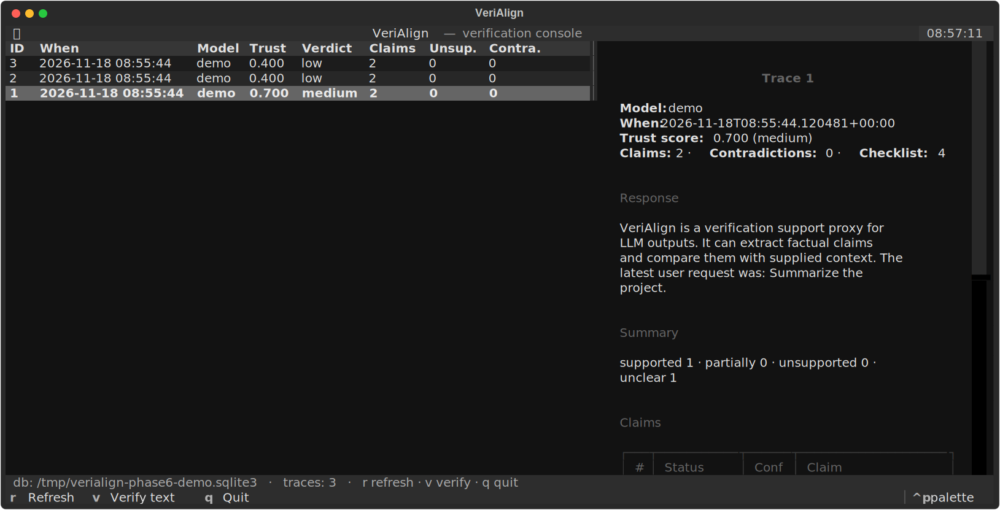
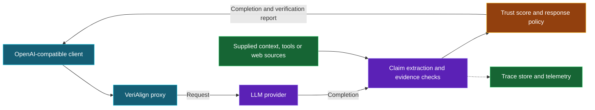

<h1 align="center">VeriAlign</h1>

<p align="center"><strong>Evidence and trust scores for OpenAI-compatible completions.</strong></p>

<p align="center">
  <a href="https://github.com/Anandhasasidharan/verialign/actions/workflows/test.yml"></a>
  <a href="https://pypi.org/project/verialign/"></a>
  <a href="https://pypi.org/project/verialign/"></a>
  <a href="LICENSE"></a>
</p>

<p align="center">
  <a href="#quick-start">Quick start</a> ·
  <a href="#offline-demo">Offline demo</a> ·
  <a href="#evaluation">Evaluation</a> ·
  <a href="#deployment">Deploy</a> ·
  <a href="ROADMAP.md">Roadmap</a>
</p>

VeriAlign is a self-hosted reverse proxy for LLM applications. Point your
OpenAI-compatible client at it, pass reference material with your request,
and receive the original completion with a claim-by-claim evidence report.
Use its response policy to pass, warn, or block. You can also verify text
directly with `POST /v1/verify`.

## What it looks like

| 🟢 Pass through | 🟠 Warn | 🔴 Block |
|---|---|---|
| Return the completion with its evidence report. | Return the completion with a low-trust warning. | Return HTTP 422 with the report when the score falls below your threshold. |



The screenshot uses the built-in upstream and three real local API requests.
[Run the offline demo](#offline-demo)

## How a request flows



<details>
<summary><strong>Grounding, caching, and routing details</strong></summary>

- **NLI grounding.** DeBERTa checks supplied context for entailment and
  refutation on a dedicated worker. One request can batch up to 64
  claim–context pairs. A cold model load can exceed the verification budget.
- **Verification cache.** Exact keys cover the completion, evidence, model,
  request settings, and confidence inputs. Valkey can share cached results
  across requests. The standalone cache supports optional semantic matching
  for entries without context.
- **Provider routing.** The proxy uses a built-in pricing table to select
  the cheapest configured provider for the requested model. Unknown models
  fall back to the first configured provider.

</details>

The project draws on research into deployment-level verification support.
[Source paper](https://arxiv.org/abs/2605.04454)

## Install

```bash
pip install verialign          # proxy + the `verialign` CLI
pip install "verialign[tui]"   # + interactive terminal console
pipx install verialign         # if you only want the command
```

Extras: `nli` (hallucination model), `semantic` (embedding cache + re-scoring),
`valkey`, `sentry`, `otel`, `tui`, `dashboard`, `migrate`, `all`.

## Quick Start

To try the version shown here, start from the repository checkout. The
built-in demo works without an upstream API key.

```bash
git clone https://github.com/Anandhasasidharan/verialign.git
cd verialign
python -m venv .venv
source .venv/bin/activate
pip install -e '.[tui]'
VERIALIGN_USE_NLI=false verialign serve
```

Verification is available through the proxy, the console, or the CLI:

| Command | What it does |
|---------|--------------|
| `verialign serve` | Run the proxy (`--host`, `--port`, `--workers`, `--reload`) |
| `verialign tui` | Interactive verification console over stored traces |
| `verialign verify --text "..."` | Verify one piece of text and print the report |
| `verialign traces --min-trust 0.5` | Trace list for scripts (`--json`) |
| `verialign migrate` | Apply database migrations (Postgres) |
| `verialign seed --count 50` | Generate demo traces |

From a source checkout:

```bash
python -m venv .venv && source .venv/bin/activate
pip install -e ".[dev]"
verialign serve --reload
```

### TUI

`verialign tui` opens a [Textual](https://textual.textualize.io/) console over the
SQLite trace store: pick a run on the left, read its claim-level verification report —
claims with status/confidence, contradictions, checklist and trust score — on the
right.

| Key | Action |
|-----|--------|
| `↑` / `↓` | Move through traces |
| `r` | Refresh the list |
| `v` | Verify your own text against context |
| `q` | Quit |

```bash
verialign tui --db ./verialign.sqlite3 --refresh 5
```

Demo request without an upstream provider:

```bash
curl -s http://127.0.0.1:8000/v1/chat/completions \
  -H "content-type: application/json" \
  -d '{
    "model": "demo",
    "messages": [{"role": "user", "content": "Summarize the project."}],
    "metadata": {
      "context": [
        {"id": "doc-1", "text": "VeriAlign is a verification support proxy for LLM outputs."}
      ]
    }
  }'
```

Dashboard (in another terminal — reads the SQLite trace store, so demo/self-host only):

```bash
pip install "verialign[dashboard]"
streamlit run verialign/dashboard/app.py
```

For a Postgres trace store, note that the TUI reads a SQLite file: point `--db` at a
SQLite export of your traces.

### Offline demo

Run the bundled demo to send three requests through the FastAPI proxy using its
built-in upstream. It shows pass-through, warning, and blocking behavior without
an API key. Omit `--db` to use a temporary trace store.

```bash
python -m verialign.scripts.demo --db /tmp/verialign-demo.sqlite3
verialign tui --db /tmp/verialign-demo.sqlite3
```

## Verification Response Shape

Non-streaming chat and direct verification return an overlay under `verification`.
Chat requests with `response_format.type: "json_object"` receive it under `data`.
Streaming chat forwards SSE completion chunks and stores the verification report
as a trace after the completion text is collected.

Selected fields from the quick-start response:

```json
{
  "verification": {
    "status": "complete",
    "trust_score": 0.7,
    "policy_action": "pass-through",
    "claims": [
      {
        "claim_id": "claim-0",
        "text": "VeriAlign is a verification support proxy for LLM outputs.",
        "label": "verified",
        "status": "supported",
        "confidence": 1.0,
        "evidence": [
          {
            "source_id": "doc-1",
            "score": 1.0,
            "excerpt": "VeriAlign is a verification support proxy for LLM outputs."
          }
        ]
      }
    ]
  }
}
```

The public Pydantic models are `Overlay` and `ClaimResult` in
`verialign.verification.overlay`. Claim confidence and non-null trust scores
range from 0 to 1. Trust is a heuristic score. Existing fields such as claim
`status`, `sources`, `sentence_offset`, and the overlay's `summary`,
`contradictions`, `checklist`, and `profile` remain available.

| Claim label | Meaning in the current contract |
|-------------|---------------------------------|
| `verified` | The engine marked the claim supported. |
| `contradicted` | A cited source refutes the claim, or the claim is one of two that conflict within the completion. |
| `no_source` | The engine did not mark the claim supported and returned no evidence for it. |
| `unverifiable` | The engine returned evidence but did not establish support or report an explicit contradiction for the claim. |

Evidence that refutes a claim includes `"refutes": true`. Legacy grounding
also uses `unsupported` for low overlap and tool conflicts, so the public
label requires a refuting source or a detected conflict within the completion.
`policy_action` reflects the applied action.
`warn` adds a warning and `block` returns HTTP 422. If verification fails
or exhausts a budget, a successful chat completion passes through with
`status: "unverifiable"` and `trust_score: null`. Completed claims remain in
the report. A claim that fails or times out receives the label `unverifiable`,
and `skipped_claims` counts claims beyond the request limit. A failure before
claim extraction can return an empty claim list.

## Comparison

| Approach | What it does | What the application receives |
|----------|--------------|-------------------------------|
| VeriAlign | Routes requests and applies claim extraction and evidence checks inline. | Completion with claim labels, evidence, and the applied policy. |
| LiteLLM Router used by itself | Selects a deployment and handles routing, retries, and fallbacks. | Provider completion. Claim verification requires an additional integration. [LiteLLM Router](https://docs.litellm.ai/docs/routing) |
| LLM-as-judge without independent evidence | Asks a model to grade an answer. Using the answer model as its own judge can repeat the same factual error. | A model judgment, whose grounding depends on the evidence supplied to the judge. |

## Features

| Feature | Description |
|---------|-------------|
| **PyPI package + CLI** | `pip install verialign` → `verialign serve` / `verify` / `traces` / `tui` / `migrate` / `seed` |
| **Terminal UI** | `verialign tui` — a Textual console for browsing claim-level verification reports |
| **Provider routing** | OpenAI, Anthropic, local Ollama, any OpenAI-compatible endpoint |
| **Cost-weighted routing** | Picks cheapest provider by model (16 model pricings) with preferred override |
| **Cost tracking** | Per-request cost from upstream `usage` + model pricing table |
| **Request validation** | Full OpenAI field support: temperature, max_tokens, tools, tool_choice, response_format |
| **Claim extraction** | Sentence rules and regex cues filter questions, hedges, first-person statements, and meta-commentary. An optional model can select additional source sentences. |
| **Source grounding** | NLI (entailment/neutral/contradiction) + keyword overlap + web search (Tavily/SerpAPI) |
| **NLI hallucination detection** | Lazy-loaded `cross-encoder/nli-deberta-v3-base` with one worker batch per request |
| **Web search grounding** | Tavily API with SerpAPI fallback, 5-min in-memory cache |
| **Verification cache** | SHA-256 exact keys scoped to verification inputs, with TTL and optional Valkey storage |
| **Contradiction detection** | Negation, antonym, and numeric conflict detection |
| **Confidence scoring** | Logprob-based (when available) + heuristic fallback |
| **Checklist generation** | Action-oriented verification checklist by category |
| **Rate limiting** | Token bucket algorithm per client IP |
| **Provider fallback** | Automatic retry on 429/5xx with alternate providers |
| **Proxy auth** | Bearer API keys for configured providers and trace reads. Demo completion and direct verification can run locally without a key when external providers are disabled. |
| **Safety middleware** | Redacts common PII in JSON and streamed chat. Applies jailbreak and directed-toxicity rules to user text. |
| **Trace persistence** | SQLite (sync) or Postgres (async) storage with sensitive data redaction |
| **Admin API** | `/admin/*` read endpoints (providers, traces, pricing, circuits) + `PUT /admin/pricing` to mutate pricing at runtime |
| **Response policy** | `pass-through` / `warn` / `block` driven by `trust_score` (per-request override via `X-VeriAlign-Policy` header) |
| **Verification batch API** | `POST /v1/verify` — verify arbitrary text + context without proxying an LLM call |
| **Tool-call grounding** | Grounds claims against `metadata.tool_calls` / `role=tool` messages (catches "refund was $50" after `process_refund(amount=45)`) |
| **Metrics** | Prometheus `/metrics` endpoint |
| **Valkey cache** | Distributed cache drop-in when `VERIALIGN_VALKEY_URL` is set |
| **Streaming** | SSE passthrough with post-stream verification and trace storage |
| **Structured output** | Nests the verification report under `data` for `response_format: {type: "json_object"}` requests |
| **Sentry** | Error tracking when `VERIALIGN_SENTRY_DSN` is set |
| **OpenTelemetry** | Optional FastAPI traces, trust-score histogram, and AgentOps trust SLI export |
| **Seed data** | Generate sample traces for demo |
| **Benchmark** | Latency + adversarial benchmark suite |

## Configuration

All via environment variables:

| Variable | Required | Default | Description |
|----------|----------|---------|-------------|
| `VERIALIGN_UPSTREAM_BASE_URL` | No | — | OpenAI-compatible API endpoint |
| `VERIALIGN_UPSTREAM_API_KEY` | No | — | API key for upstream provider |
| `VERIALIGN_ANTHROPIC_API_KEY` | No | — | Anthropic API key |
| `VERIALIGN_LOCAL_BASE_URL` | No | — | Local Ollama endpoint |
| `VERIALIGN_UPSTREAM_TIMEOUT_SECONDS` | No | 60 | Request timeout |
| `VERIALIGN_DB_PATH` | No | ./verialign.sqlite3 | SQLite database path |
| `VERIALIGN_DATABASE_URL` | No | — | Postgres DSN (async) overrides DB_PATH |
| `VERIALIGN_PROXY_API_KEY` | For deployed providers and trace reads | — | Accepts `Authorization: Bearer <key>`. A configured key protects chat, direct verification, and trace reads. |
| `VERIALIGN_REQUIRE_PROXY_AUTH` | No | false | Also require a key for demo requests. Missing required configuration returns HTTP 503. |
| `VERIALIGN_RATE_LIMIT_RPM` | No | 60 | Requests per minute per client |
| `VERIALIGN_RATE_LIMIT_TPM` | No | 100000 | Tokens per minute per client |
| `VERIALIGN_RATE_LIMIT_KEY_RPM` | No | 300 | Requests/min per API key |
| `VERIALIGN_RATE_LIMIT_KEY_TPM` | No | 500000 | Tokens/min per API key |
| `VERIALIGN_REDACT_TRACES` | No | true | Scrub recognized PII and credentials from request, response, and verification fields on trace writes and reads |
| `VERIALIGN_MAX_REQUEST_BODY_SIZE` | No | 10485760 | Request body size limit (bytes) |
| `VERIALIGN_PROXY_TIMEOUT_SECONDS` | No | 120 | Initial request deadline (seconds). Chat uses any remaining time to cap its verification window after upstream success. |
| `VERIALIGN_CORS_ALLOWED_ORIGINS` | No | `[]` | Allowed CORS origins (opt-in JSON list) |
| `VERIALIGN_RESPONSE_POLICY` | No | pass-through | `pass-through` \| `warn` \| `block` |
| `VERIALIGN_BLOCK_THRESHOLD` | No | 0.5 | trust_score below which warn/block applies |
| `VERIALIGN_USE_RESCORING` | No | false | Claim-conditioned re-scoring (needs `semantic` extra) |
| `VERIALIGN_USE_NLI`     | No | true  | Lazy-loaded NLI grounding (`cross-encoder/nli-deberta-v3-base`). Needs the `nli` extra. Set false to disable NLI for offline runs. |
| `VERIALIGN_USE_LLM_EXTRACTOR` | No | false | Let a configured provider select additional claims from sentences left undecided by the rules |
| `VERIALIGN_LLM_EXTRACTOR_MODEL` | No | — | Optional extractor model override. Defaults to the request model when present. |
| `VERIALIGN_VERIFICATION_MAX_CLAIMS` | No | 16 | Maximum claims checked per request |
| `VERIALIGN_VERIFICATION_MAX_MS` | No | 2000 | Verification window in milliseconds |
| `VERIALIGN_VERIFICATION_CLAIM_TIMEOUT_MS` | No | 1200 | Time limit for an individual claim after it acquires a concurrency slot |
| `VERIALIGN_VERIFICATION_CONCURRENCY` | No | 4 | Maximum in-flight claim checks per request |
| `VERIALIGN_VALKEY_URL` | No | — | Valkey connection string |
| `VERIALIGN_ADMIN_API_KEY` | No | — | Admin API key (`X-Admin-Key` header) |
| `VERIALIGN_SENTRY_DSN` | No | — | Sentry DSN for error tracking |
| `VERIALIGN_ENABLE_OTEL` | No | false | Enable OpenTelemetry instrumentation and trust-score recording. Install the `otel` extra. |
| `VERIALIGN_AGENTOPS_TRACES_ENDPOINT` | No | — | Full AgentOps OTLP JSON receiver URL, including `/v1/traces` |
| `VERIALIGN_AGENTOPS_API_KEY` | With AgentOps export | — | AgentOps tenant credential sent as `X-API-Key` |
| `VERIALIGN_ALERT_WEBHOOK_URL` | No | — | Webhook for unsupported/contradiction alerts |
| `VERIALIGN_ALERT_SLACK_WEBHOOK_URL` | No | — | Slack webhook for alerts |
| `VERIALIGN_WEB_SEARCH_API_KEY` | No | — | Tavily API key for web search grounding |
| `VERIALIGN_WEB_SEARCH_PROVIDER` | No | tavily | Web search provider (tavily/serpapi) |
| `VERIALIGN_SAFETY_PII_REDACT_ENABLED` | No | true | Enable PII redaction |
| `VERIALIGN_SAFETY_JAILBREAK_ENABLED` | No | true | Enable jailbreak detection |
| `VERIALIGN_SAFETY_TOXICITY_ENABLED` | No | true | Enable toxicity filtering |

### OpenTelemetry and AgentOps

Install the `otel` extra and set these variables in the proxy process environment
to export the `verialign.verification.trust_score` histogram to an OTLP/HTTP
collector. Each scored result contributes one sample for its operation and
applied response policy. Missing scores are excluded.

```bash
pip install -e '.[otel]'
export VERIALIGN_ENABLE_OTEL=true
export OTEL_EXPORTER_OTLP_METRICS_ENDPOINT=http://localhost:4318/v1/metrics
verialign serve
```

For AgentOps, create an SLI via `POST /api/v1/slis` for the receiving tenant
with this JSON and the tenant's `X-API-Key` header.

```json
{"name": "trust_score", "metric_type": "threshold", "source": "otel_attribute"}
```

Set
`VERIALIGN_AGENTOPS_TRACES_ENDPOINT` to the AgentOps `/v1/traces` URL and
`VERIALIGN_AGENTOPS_API_KEY` to the receiving tenant's key. The proxy sends
`gen_ai.eval.trust_score` on an OTLP JSON span so AgentOps can derive the SLI.
Set `agentops.agent.id` and `agentops.environment` in
`OTEL_RESOURCE_ATTRIBUTES` to group by a different agent or environment.
Defaults are `verialign` and `production`. This export sends score and
operational metadata only. For AgentOps alone, set `OTEL_TRACES_EXPORTER=none`
and `OTEL_METRICS_EXPORTER=none` to disable the standard collector exporters.
[AgentOps ingestion source](https://github.com/Anandhasasidharan/AgentOps-Agent-System-Operations/blob/3a477231e6be84ba47c7d86062094c892ece9774/agent-slo-platform/src/agent_slo/receiver.py#L216)

## Evaluation

| Profile on the frozen FEVER set | Refutations detected | Refuted claims marked verified |
|---|---:|---:|
| 🟣 NLI using supplied evidence | **77/100** | **5/100** |
| 🔵 Keyword using supplied evidence | **0/100** | **38/100** |

<details>
<summary><strong>Keyword baseline, calibration, and latency</strong></summary>

The frozen offline test uses 300 FEVER claims with balanced labels and
annotated evidence on known-truth examples. **Verified locally** using the
keyword verification profile.

| Measure | Frozen baseline | Final |
|---|---:|---:|
| Verified F1 | 0.503 | 0.613 |
| Contradicted F1 | 0.000 | 0.000 |
| Exact unverifiable F1 | 0.000 | 0.000 |
| Abstention F1, including `no_source` | 0.548 | 0.650 |
| Trust calibration error (ECE, lower is better) | 0.173 | 0.228 |
| Refuted claims marked verified | 31/100 | 38/100 |
| Paired proxy overhead p50 / p95 | 22.63 / 26.98 ms | 17.67 / 24.45 ms |

The highest trust bin averaged 0.913 while 59.4% of its claims were supported.
The latency sample uses in-process ASGI with telemetry disabled.
[Full evaluation and reproduction commands](eval/report.md) · [Current keyword run](eval/roadmap-keyword.json)

</details>

**Verified with NLI and supplied evidence.** On the same frozen set,
DeBERTa found 77 of 100 refutations with 92.8% precision. Five refuted claims
were marked verified. On a separate held-out FEVER slice, experimental
calibration reduced NLI trust ECE from 0.109 to 0.033. The runtime continues
to emit its heuristic score. [NLI and calibration results](eval/report.md#refutation-and-calibration-follow-up)

## Project Structure

```
VeriAlign/
├── README.md
├── ROADMAP.md
├── AGENTS.md
├── LICENSE
├── pyproject.toml
├── MANIFEST.in
├── .env.example
├── alembic.ini                           # dev convenience (migrations ship in the package)
├── verialign/
│   ├── cli.py                            # `verialign` console entry point
│   ├── __main__.py                       # `python -m verialign`
│   ├── migrations/                       # Alembic migrations (packaged)
│   ├── tui/
│   │   ├── app.py                        # Textual console (`verialign tui`)
│   │   └── data.py                       # Trace reading + Markdown rendering
│   ├── proxy/
│   │   ├── main.py                       # FastAPI entry point
│   │   ├── admin.py                      # Admin API (/admin/*)
│   │   ├── config.py                     # Settings from env vars
│   │   ├── otel_genai.py                 # GenAI semantic-convention spans
│   │   ├── middleware/
│   │   │   ├── rate_limiter.py           # Token bucket (per IP + per API key)
│   │   │   ├── request_handler.py        # Validate incoming requests
│   │   │   ├── response_handler.py       # Augment + response policy (warn/block)
│   │   │   ├── safety_middleware.py      # PII redaction, jailbreak, toxicity
│   │   │   ├── metrics_middleware.py     # Prometheus /metrics
│   │   │   ├── logging_middleware.py     # Structured JSON logging + request IDs
│   │   │   ├── body_size_limit.py        # Request body size guard
│   │   │   └── request_timeout.py        # Request timeout guard
│   │   └── routing/
│   │       ├── provider_router.py        # Route to OpenAI/Anthropic/local
│   │       ├── cost_model.py             # Model pricing table
│   │       ├── circuit_breaker.py        # Per-provider circuit breaker
│   │       └── fallback.py               # Provider fallback on failure
│   ├── verification/
│   │   ├── engine.py                     # Orchestrates verification pipeline
│   │   ├── claim_extractor.py            # Claim extraction + decomposition
│   │   ├── source_grounder.py            # NLI + keyword + web + re-scoring
│   │   ├── nli_grounder.py               # cross-encoder/nli-deberta-v3-base
│   │   ├── tool_grounder.py              # Ground claims vs tool-call records
│   │   ├── trust_scorer.py               # Aggregate trust_score
│   │   ├── contradiction_detector.py     # Cross-check internal contradictions
│   │   ├── confidence_scorer.py          # Logprob + heuristic scoring
│   │   ├── checklist_generator.py        # Actionable verification checklists
│   │   ├── alerting.py                   # Webhook/Slack alerts
│   │   ├── verification_cache.py         # Cache (exact + semantic near-match)
│   │   ├── valkey_cache.py               # Valkey-backed cache
│   │   ├── web_grounder.py               # Tavily/SerpAPI web search
│   │   └── models.py                     # Dataclasses for verification data
│   ├── storage/
│   │   ├── models.py                     # SQLAlchemy ORM models
│   │   ├── trace_store.py                # SQLite persistence
│   │   ├── async_trace_store.py          # Postgres (async) persistence
│   │   ├── store_factory.py              # Choose sync/async store
│   │   └── metrics_store.py              # Aggregated metrics queries
│   ├── scripts/
│   │   ├── benchmark_claims.py           # Claim-extraction benchmark (CI)
│   │   ├── benchmark_verification.py     # Verification + calibration (CI)
│   │   ├── audit_saboteur.py             # Overt-saboteur catch-rate audit (CI)
│   │   ├── adversarial_benchmark.py      # Adversarial claim suite
│   │   ├── benchmark.py                  # Latency benchmarking
│   │   └── seed_data.py                  # Generate sample traces
│   ├── deploy/
│   │   ├── Dockerfile
│   │   ├── Dockerfile.dashboard
│   │   ├── docker-compose.yml
│   │   ├── docker-compose.prod.yml
│   │   └── Caddyfile
│   └── dashboard/
│       └── app.py                        # Streamlit entry point
├── tests/                                # one test_<module>.py per module
├── docs/
│   ├── architecture.md
│   ├── deployment.md
│   ├── paper-summary.md
│   ├── interview-pitch.md
│   ├── VeriAlign.md                       # Product/positioning overview
│   ├── distilgpt2.md                      # LLM-as-judge experiment notes
│   ├── verification-calibration.md       # Reliability diagram + ECE
│   └── distilgpt2-test-results.md        # Ad-hoc LLM-as-judge validation
├── scripts/
│   └── audit_saboteur.py                 # Top-level audit runner (CI)
└── .github/workflows/
    ├── test.yml                          # pytest (3.11/3.12) + benchmarks + ruff + gitleaks + build
    ├── publish.yml                       # Trusted Publishing to TestPyPI + PyPI on tags
    └── deploy.yml
```

## API Endpoints

| Method | Path | Description |
|--------|------|-------------|
| GET | `/health` | Database check and upstream configuration status |
| GET | `/ready` | Returns 503 when the trace store cannot be read or required proxy-key configuration is missing |
| POST | `/v1/chat/completions` | Chat completion with inline verification |
| POST | `/v1/verify` | Verify arbitrary `{text, context}` without proxying |
| GET | `/traces?limit=25` | List recent traces (proxy Bearer key required) |
| GET | `/metrics` | Prometheus metrics |
| GET | `/admin/health` | Admin health/version (admin key required) |
| GET | `/admin/providers` | Configured providers (admin key required) |
| GET | `/admin/traces` | All traces (admin key required) |
| GET | `/admin/pricing` | Model pricing table (admin key required) |
| PUT | `/admin/pricing` | Add/update a model's pricing at runtime (admin key required) |
| GET | `/admin/circuits` | Provider circuit-breaker status (admin key required) |

## Deployment

```bash
# Demo (SQLite, one container)
docker compose -f verialign/deploy/docker-compose.yml up -d

# Production (Postgres+Valkey+Caddy TLS, 4 workers, healthchecks)
# 1) cp .env.example .env && set VERIALIGN_PROXY_API_KEY, VERIALIGN_ADMIN_API_KEY, POSTGRES_PASSWORD, VERIALIGN_DOMAIN
# 2) docker compose -f verialign/deploy/docker-compose.prod.yml up -d
#    -> Caddy auto-TLS to https://your.domain, proxy + dashboard behind it
#    -> verialign migrate runs on start, /health and /metrics behind allowlist

# Fly.io / Railway
flyctl launch && flyctl deploy  # or railway up
```

See `docs/deployment.md` for systemd, Caddyfile, and prod env checklist.

**Prod env checklist:** `VERIALIGN_DATABASE_URL` (or `POSTGRES_PASSWORD` for compose), `VERIALIGN_VALKEY_URL`, `VERIALIGN_REQUIRE_PROXY_AUTH=true`, `VERIALIGN_CORS_ALLOWED_ORIGINS='["https://your.domain"]'` (JSON list — an empty list allows no cross-origin requests), `VERIALIGN_RESPONSE_POLICY=warn|block`, `VERIALIGN_BLOCK_THRESHOLD=0.55`, `VERIALIGN_REDACT_TRACES=true`.

## API Notes

- Chat responses include a `cost` field when usage and model pricing allow a cost estimate
- Admin endpoints require `X-Admin-Key` header matching `VERIALIGN_ADMIN_API_KEY`
- Configure a proxy Bearer key before connecting an upstream provider or enabling web grounding.
- Admin is read-only except `PUT /admin/pricing`. When no admin key is set, all
  `/admin/*` endpoints return `503` (disabled), not `200`
- `metadata.context` may be a list of strings or objects with `id` and `text`
- `metadata.tool_calls` (or `role: "tool"` messages) are grounded against the response
- Per-request policy override: send `X-VeriAlign-Policy` (`pass-through`/`warn`/`block`)
  and optional `X-VeriAlign-Block-Threshold`
- If no upstream provider is configured, VeriAlign uses demo mode
- With model extraction enabled, the proxy sends only undecided completion sentences to the configured provider and validates its JSON sentence indices. The model can use up to 40% of the verification window. Invalid output or an extractor timeout leaves the rule-selected claims available. Set an extractor model or include a model in the request when using this option with `/v1/verify`.
- Streaming (`stream=true`) is supported via SSE — post-stream verification is stored after the stream ends

### Privacy behavior

Default application logs record event metadata and omit prompt and response
bodies, URL queries, and the startup settings dump. Uvicorn access logs are disabled
by default. Trace storage is separate and retains scrubbed content for review.
An existing database may contain older raw values on disk.

Response redaction covers common email, phone, SSN, and Luhn-valid card formats.
Labels such as order, invoice, and ISBN help distinguish ordinary identifiers.
Chat logprobs are suppressed while redaction is enabled because token bytes can
reconstruct sensitive text. SSE text is held until its suffix can be checked,
and structured JSON or tool arguments are released when complete. The pattern
checks are heuristic and apply to text. Images and audio are outside their scope.

## Tests

```bash
# Run all tests
python -m pytest tests/ -v

# With coverage
python -m pytest tests/ --cov=verialign

# Run lint & format check
python -m ruff check verialign/ tests/
python -m ruff format --check verialign/ tests/
```

## Acknowledgements

- **arXiv:2605.04454 — Vishwarupe et al., Oxford, May 2026** — *Deployment-Relevant Alignment Cannot Be Inferred from Model-Level Evaluation Alone* — the paper that identified the verification gap
- **Anthropic Engineering Blog** — Proxy/containment architecture patterns
- **Bifrost AI Gateway** — Reference for production AI gateway architecture
