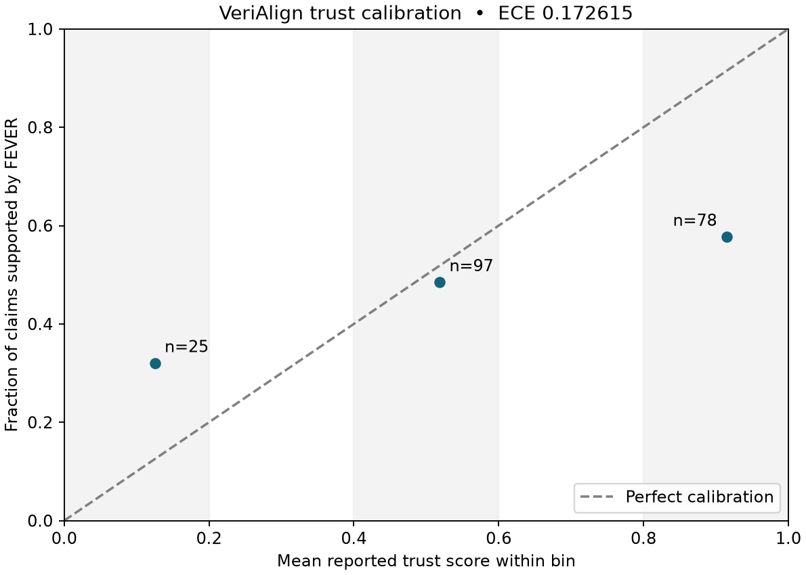

# VeriAlign FEVER baseline

## Results

**VERIFIED.** The offline keyword verifier produced zero `contradicted`
predictions and marked 31 of the 100 refuted claims as `verified`.
It did not return the whole input claim for 95 of the 300 examples.

| Label | Precision | Recall | F1 | TP / FP / FN |
|---|---:|---:|---:|---:|
| Verified | 0.586667 | 0.440000 | 0.502857 | 44 / 31 / 56 |
| Contradicted | 0.000000 | 0.000000 | 0.000000 | 0 / 0 / 100 |
| Unverifiable, exact | 0.000000 | 0.000000 | 0.000000 | 0 / 63 / 100 |
| Abstention, including no source | 0.484615 | 0.630000 | 0.547826 | 63 / 67 / 37 |

All 63 correct abstentions were `no_source`. The strict `unverifiable`
label only appeared on known-truth examples. In this baseline,
`contradicted` requires an explicit conflict between extracted claims,
while FEVER refutes a claim using supplied evidence.

### Trust calibration

**VERIFIED.** ECE was **0.172615** on 200 known-truth claims. The highest
bin averaged **0.914679** trust and **0.576923** actual correctness.

| Trust bin | Count | Mean trust | Actual correctness |
|---|---:|---:|---:|
| [0.0, 0.2) | 25 | 0.125400 | 0.320000 |
| [0.2, 0.4) | 0 | — | — |
| [0.4, 0.6) | 97 | 0.518691 | 0.484536 |
| [0.6, 0.8) | 0 | — | — |
| [0.8, 1.0] | 78 | 0.914679 | 0.576923 |



### Latency

**VERIFIED.** All 100 timed pairs completed and returned the same completion
content. A second run reproduced classification, confusion counts, and
calibration exactly. Its paired overhead differed by −0.512 ms at p50 and
+0.532 ms at p95.

| Local ASGI measurement | p50 (ms) | p95 (ms) |
|---|---:|---:|
| Direct upstream | 4.636 | 6.253 |
| Full proxy | 27.550 | 32.357 |
| Paired proxy overhead | 22.629 | 26.982 |

The app suite returned `319 passed, 3 skipped, 1 warning in 36.53s`, with
`80%` statement coverage for `verialign`. Networked deployment latency,
concurrent traffic, and model-backed NLI or retrieval quality remain
**UNVERIFIED**. [Frozen baseline](baseline.json) · [Evaluation dataset](datasets/fever_dev_300.jsonl)

## Dataset and attribution

The evaluation uses 300 claims from FEVER's Shared Task Development split, with
100 each from `SUPPORTS`, `REFUTES`, and `NOT ENOUGH INFO`. Within each label,
the builder orders rows by SHA-256 of the fixed seed
`verialign-fever-dev-v1` and the claim ID, then takes the first 100. It preserves
the original claim and label. For known-truth examples, it supplies the first
complete annotated evidence set from FEVER's Wikipedia snapshot. Unknown-truth
examples have an empty context. The input therefore measures verification with
supplied evidence. It does not measure evidence retrieval or estimate real-world
label prevalence.

The builder normalizes page titles to NFC for evidence joins and preserves the
annotated page title and line number in each source ID.

FEVER was created by James Thorne, Andreas Vlachos, Christos
Christodoulopoulos, and Arpit Mittal. Evidence text comes from the Wikipedia
pages linked in each JSONL row. The subset selects and reformats FEVER records,
removes annotation metadata and duplicate evidence references, and adds
evaluation labels and attribution URLs. FEVER's terms retain the applicable
Wikipedia article license, with CC BY-SA 3.0 where the page-specific terms are
unavailable. [Dataset](https://fever.ai/dataset/fever.html) · [License](https://fever.ai/download/fever/license.html) · [CC BY-SA 3.0](https://creativecommons.org/licenses/by-sa/3.0/)

## Scoring method

- **Classification.** The expected labels are `verified` for `SUPPORTS`,
  `contradicted` for `REFUTES`, and `unverifiable` for `NOT ENOUGH INFO`.
  A prediction must match the whole input claim after normalizing case,
  whitespace, and ending punctuation. When extraction omits or splits the
  input, the evaluator records `missing_claim` and gives no classification
  credit. Precision is zero when a label has no positive predictions.
- **Abstention.** Exact `unverifiable` is reported on its own. The additional
  abstention metric credits either `unverifiable` or `no_source` for an
  unknown-truth claim. In this dataset, the explicit absence of context makes
  `no_source` a valid operational abstention.
- **Calibration.** The five equal-width trust bins use FEVER's actual
  support rate as the outcome. Supported and refuted cases have known truth
  labels. Unknown-truth cases and null trust scores are excluded and counted.
  ECE is the sample-weighted mean of the absolute gap between each bin's mean
  trust and its support rate. The rightmost bin includes 1.0.
- **Latency.** The runner compares direct requests to a deterministic
  OpenAI-style upstream with requests through the real chat route to that
  same upstream, both using in-process ASGI. The proxy path includes middleware,
  routing, verification, serialization, and temporary SQLite trace writes.
  Measurement uses 10 warm-up pairs and 100 timed pairs in alternating order.
  Each pair uses a distinct claim so repeated-response cache hits do not
  dominate the measurement.
  Paired overhead percentiles come from the per-pair differences. This excludes
  sockets, external model latency, and concurrent load.

The fixed `offline-keyword-v1` profile runs the real regex extractor and
decomposer, keyword grounder, contradiction detector, scorer, and overlay.
NLI, embeddings, web search, and LLM extraction are disabled for the baseline.
NLI is a separate runtime profile to evaluate in later phases. The result JSON
records the dataset hash, VeriAlign source hash, and runtime versions.

## Reproduce and compare

Run from the checkout with the usual VeriAlign Python dependencies. Install
`matplotlib` to write a plot.

```bash
python -m eval.run_eval --compare eval/baseline.json \
  --output /tmp/verialign-eval.json --plot /tmp/verialign-calibration.png
```

The runner prints deltas in precision, recall, F1, ECE, and paired latency
against the frozen baseline. It checks that the dataset, evaluation profile,
and latency sampling match before comparing. The downloaded archives are
needed only to recreate the sample.

| Official input | SHA-256 |
|---|---|
| `shared_task_dev.jsonl` | `e89865bfe1b4dd054e03dd57d7241a6fde24862905f31117cf0cd719f7c78df7` |
| `wiki-pages.zip` | `4b06d95da6adf7fe02d2796176c670dacccb21348da89cba4c50676ab99665f2` |

```bash
curl -fL https://fever.ai/download/fever/shared_task_dev.jsonl -o /tmp/fever-dev.jsonl
curl -fL https://fever.ai/download/fever/wiki-pages.zip -o /tmp/fever-wiki.zip
python -m eval.build_dataset /tmp/fever-dev.jsonl /tmp/fever-wiki.zip \
  /tmp/fever_dev_300.jsonl
cmp eval/datasets/fever_dev_300.jsonl /tmp/fever_dev_300.jsonl
```

## Phase 3 comparison

**VERIFIED.** The frozen 300-item offline profile reproduced the baseline's
classification and confusion counts. Every precision, recall, and F1 delta
was zero. Trust ECE remained **0.172615** over 200 known-truth claims.

| Local ASGI measurement | Baseline p50 / p95 (ms) | Phase 3 p50 / p95 (ms) |
|---|---:|---:|
| Direct upstream | 4.64 / 6.25 | 4.39 / 8.11 |
| Full proxy | 27.55 / 32.36 | 29.64 / 45.26 |
| Paired proxy overhead | 22.63 / 26.98 | 25.42 / 37.60 |

A repeat after the model download finished measured **23.25 / 31.41 ms**
paired overhead. Both keyword-path runs measured higher p95 overhead
than the baseline. [Phase 3 eval output](phase3.json)

In a separate async fixture with 12 claims and 50 ms of source wait per
claim, median verification time over three runs was **606.44 ms** with
one slot and **153.14 ms** with four. The actual DeBERTa checkpoint produced
`supported` and `unsupported` for a supporting and a refuting example
in a warm **234.21 ms** CPU batch with two claims and two sources. This
was a smoke test of one batch. FEVER quality with NLI enabled remains
**UNVERIFIED**.

## Phase 4 comparison

**VERIFIED.** The default rules raised verified F1 by **0.110208** and
abstention F1 by **0.101809** on the frozen 300 claims. The rule extractor
missed 27 whole claims, down from 95. The seven-case internal extraction
fixture also improved from **0.769** to **0.889** F1. We kept the rules for
these F1 gains. Calibration worsened and the number of refuted claims
marked verified rose from 31 to 38.

| Frozen FEVER measure | Phase 3 | Phase 4 rules |
|---|---:|---:|
| Verified precision / recall / F1 | 0.586667 / 0.440000 / 0.502857 | 0.616162 / 0.610000 / 0.613065 |
| Abstention precision / recall / F1 | 0.484615 / 0.630000 / 0.547826 | 0.511494 / 0.890000 / 0.649635 |
| Contradicted F1 | 0 | 0 |
| Exact unverifiable F1 | 0 | 0 |
| Trust ECE | 0.172615 | 0.228445 |
| Paired overhead p50 / p95 (ms) | 25.42 / 37.60 | 21.34 / 23.00 |

The Phase 4 direct upstream measured **3.52 / 4.23 ms** and the proxied
path measured **24.75 / 26.63 ms**. Paired overhead was **1.29 / 3.98 ms**
lower than the original Phase 2 baseline in this run. These are local
ASGI samples. [Phase 4 rule evaluation](phase4.json)

### Optional model selection

The configured provider sees the unresolved sentences and returns strict JSON
sentence indices. The verifier validates the indices against the input and
keeps the rule-selected claims on invalid output or timeout.

**VERIFIED.** SmolLM2-135M-Instruct and Qwen2.5-0.5B-Instruct with a two-second
extractor deadline each produced zero F1 and ECE change over the rules. A
second Qwen trial assigned a 16-second extractor window within a 40-second
verification budget. Eight of 25 calls returned valid nonempty selections
and 17 were rejected by the schema or index check. Abstention F1 improved
from **0.649635** to **0.657040** and all exact label F1 scores stayed the
same. ECE rose from **0.228445** to **0.229340**. Local generation took
**5.30 / 7.00 seconds** at p50 / p95. The feature stays off by default
given the measured latency and limited gain. Hosted-provider behavior and
results on other datasets remain **UNVERIFIED**. [Measured Qwen trial](phase4-llm.json)

The trial uses a local Transformers checkpoint and requires `torch`,
`transformers`, and `jinja2`. The artifact records the exact checkpoint
revision. The probe uses greedy generation on CPU.

```bash
python -m eval.run_llm_trial /path/to/checkpoint \
  --model-id Qwen/Qwen2.5-0.5B-Instruct@7ae557604adf67be50417f59c2c2f167def9a775 \
  --max-ms 40000 --output /tmp/verialign-llm-trial.json
```

## Phase 5 comparison

**VERIFIED.** All 300 frozen FEVER cases reproduced the Phase 4 confusion
counts, precision, recall, and F1. Trust ECE remained **0.228445**.
The synthetic proxy arm used a Bearer key for its configured test upstream.

| Measure | Phase 4 | Phase 5 |
|---|---:|---:|
| Tests passed / skipped | 347 / 3 | 384 / 3 |
| App statement coverage | 82% | 84% |
| Safety middleware statement coverage | 77% | 91% |
| Verified F1 / abstention F1 | 0.613065 / 0.649635 | 0.613065 / 0.649635 |
| Contradicted F1 / exact unverifiable F1 | 0 / 0 | 0 / 0 |
| Direct upstream p50 / p95 (ms) | 3.52 / 4.23 | 3.17 / 3.69 |
| Full proxy p50 / p95 (ms) | 24.75 / 26.63 | 21.82 / 24.31 |
| Paired proxy overhead p50 / p95 (ms) | 21.34 / 23.00 | 18.87 / 21.15 |

The Phase 5 paired overhead was **3.75 / 5.83 ms lower** than the original
Phase 2 snapshot in this local sample. [Phase 5 eval output](phase5.json)

A separate local Uvicorn probe returned 401 for anonymous chat and trace reads
with a proxy key configured, 403 for a proxy key on an admin route, and 200
for the admin key. Authenticated JSON and SSE responses masked all four
synthetic PII values. SSE ended with `[DONE]`. The operational log contained
the chat event and none of the submitted prompt, query, PII, or key markers.
Live PostgreSQL and production logging integrations remain **UNVERIFIED**.

## Phase 6 and final comparison

**VERIFIED.** Phase 6 reproduced every Phase 5 label and calibration result on
the frozen FEVER run. Paired p50 and p95 overhead rose by 0.44 and 1.08 ms in
this local sample and remained below the Phase 2 baseline.

| Measure | Phase 0 audit or Phase 2 frozen baseline | Final |
|---|---:|---:|
| Tests passed / skipped | 310 / 3 | 385 / 3 |
| App statement coverage | 78% | 84% |
| Safety middleware statement coverage | 77% | 91% |
| Seven-case extraction precision / recall / F1 | 0.714 / 0.833 / 0.769 | 0.800 / 1.000 / 0.889 |
| Ten-case offline verification accuracy | 3/10 | 3/10 |
| Unsupported examples correctly labeled in that fixture | 0/4 | 0/4 |
| Claim confidence ECE in that fixture | 0.2467 | 0.2467 |
| FEVER verified precision / recall / F1 | 0.586667 / 0.440000 / 0.502857 | 0.616162 / 0.610000 / 0.613065 |
| FEVER contradicted precision / recall / F1 | 0 / 0 / 0 | 0 / 0 / 0 |
| FEVER exact unverifiable precision / recall / F1 | 0 / 0 / 0 | 0 / 0 / 0 |
| FEVER abstention precision / recall / F1 | 0.484615 / 0.630000 / 0.547826 | 0.511494 / 0.890000 / 0.649635 |
| FEVER trust ECE | 0.172615 | 0.228445 |
| Missing whole claims | 95/300 | 27/300 |
| Refuted claims marked verified | 31/100 | 38/100 |
| Highest trust bin, mean score / actual support | 0.914679 / 0.576923 | 0.913099 / 0.594059 |
| Direct upstream p50 / p95 (ms) | 4.64 / 6.25 | 3.18 / 3.95 |
| Full proxy p50 / p95 (ms) | 27.55 / 32.36 | 22.88 / 25.38 |
| Paired proxy overhead p50 / p95 (ms) | 22.63 / 26.98 | 19.32 / 22.23 |

[Frozen baseline JSON](baseline.json) · [Final JSON](phase6.json)

### Integration evidence

- **VERIFIED.** The export test decoded a real OTLP/HTTP Protobuf histogram.
  It received four recorded scores covering pass-through streaming chat,
  warned and blocked chat, and direct verification. Unscored results were
  excluded. The separate AgentOps payload carried the same scores and did
  not contain the test prompt, completion text, or model canaries.
- **VERIFIED.** A local AgentOps receiver at revision
  `3a477231e6be84ba47c7d86062094c892ece9774` received real HTTP traffic and
  persisted three trust samples for chat, streaming chat, and direct
  verification. A separate probe registered the documented threshold SLI
  through its API (HTTP 201) and read back the direct verification score
  (1.0) from SQLite.
- **VERIFIED.** The offline demo returned 200 with 0.70 for pass-through,
  200 with 0.40 for warn, and 422 with 0.40 for block. The screenshot was
  captured from the Textual console reading its three stored traces.
  [Demo screenshot](../docs/verialign-demo.png)

### Remaining limitations

The default keyword profile found zero explicit contradictions on this FEVER
sample and scored 38 refuted claims as verified. All 89 correct abstentions
used `no_source`. The frozen test supplies evidence and uses a balanced label
mix. Retrieval quality, production calibration, and NLI-enabled FEVER
performance are **UNVERIFIED**. The optional extraction model trial was
measured in Phase 4. Final latency was measured locally with telemetry off.
Throughput under load, telemetry overhead, and hosted AgentOps ingestion
remain **UNVERIFIED**.

### Suggested roadmap

1. Add evidence-level refutation and measure it against the frozen fixture
   and a separate held-out split. Track false verification of refuted claims.
2. Calibrate trust on an independent dataset and measure threshold decisions,
   subgroup errors, and high-trust overconfidence.
3. Run the same evaluation with NLI and retrieval. Load-test a deployment
   with Postgres and an OTLP collector, including collector outages.

## Refutation and calibration follow-up

**VERIFIED.** NLI now uses the source as the premise and the claim as the
hypothesis. It cites the source that drove a refutation. Strong evidence
on both sides produces an abstention, and neutral NLI no longer promotes
keyword similarity to verification. The keyword profile detects exact
negation and conflicting birth years in targeted fixtures. It still found
zero refutations on the frozen FEVER slice.

| Frozen FEVER result | Phase 6 keyword | Phase 6 NLI replay | Current NLI |
|---|---:|---:|---:|
| Refutations identified | 0/100 | 0/100 | 77/100 |
| Contradicted precision / recall / F1 | 0 / 0 / 0 | 0 / 0 / 0 | 0.928 / 0.770 / 0.842 |
| Refuted claims marked verified | 38/100 | 14/100 | 5/100 |
| Verified precision / recall / F1 | 0.616 / 0.610 / 0.613 | 0.806 / 0.580 / 0.674 | 0.909 / 0.500 / 0.645 |
| Exact unverifiable precision / recall / F1 | 0 / 0 / 0 | 0 / 0 / 0 | 0 / 0 / 0 |
| Abstention F1 | 0.650 | 0.591 | 0.757 |
| Trust ECE | 0.228445 | 0.165171 | 0.068270 |
| Highest trust bin, mean score / actual support | 0.913 / 59.4% | 0.920 / 80.3% | 0.996 / 90.9% |

The current NLI profile also marked six supported claims contradicted on the
frozen slice. It abstained or missed 44 more. The Phase 6 replay used the
Phase 6 wheel (SHA-256
`c1d964004e004b1d21f090d141bff4d4fb7e25b8fa849064a44221388daf0d86`).
Both NLI runs used checkpoint
`cross-encoder/nli-deberta-v3-base@6c749ce3425cd33b46d187e45b92bbf96ee12ec7`,
CPU execution, and FEVER's supplied evidence. Current keyword labels and ECE
matched Phase 6. Its sequential local paired proxy overhead p50/p95 was
17.67/24.45 ms, compared with 19.32/22.23 ms in Phase 6.
[Phase 6 NLI replay](roadmap-phase6-nli-replay.json) · [Current keyword eval](roadmap-keyword.json) · [Current NLI eval](roadmap-nli-calibration.json)

### Held-out calibration

**VERIFIED.** Two additional 300-claim FEVER development slices exclude
normalized claim texts from the frozen slice and from each other. Each is
balanced across the three labels. Isotonic regression fit on 200 known-truth
examples from the fit slice. The table uses the 200 different known-truth
examples in the held-out slice. NLI identified 85 of its 100 refutations with
95.5% precision and marked two refuted claims verified.

| Held-out profile | Raw ECE | Calibrated ECE | Raw Brier | Calibrated Brier |
|---|---:|---:|---:|---:|
| Keyword | 0.239455 | 0.038778 | 0.296227 | 0.211610 |
| NLI | 0.108755 | 0.033471 | 0.147626 | 0.114043 |

At the NLI threshold of 0.8, calibration moved supported/refuted claims
above threshold from 66/2 to 53/1. At 0.5 it moved those counts from 70/8
to 87/14. Production policy continues to use the heuristic score. A balanced
single-claim test with supplied evidence leaves multi-claim and production
calibration **UNVERIFIED**.
[Keyword calibration](roadmap-keyword-calibration.json) · [Fit slice](datasets/fever_calibration_fit_300.jsonl) · [Held-out slice](datasets/fever_calibration_test_300.jsonl)

To reproduce from the checkout, use Python with scikit-learn and the
`nli` extra. Pass the path to the pinned checkpoint snapshot in
`NLI_CHECKPOINT` for the NLI run. Omit `--nli-model` to run the offline
keyword profile.

```bash
OMP_NUM_THREADS=4 MKL_NUM_THREADS=4 python -m eval.run_calibration \
  eval/datasets/fever_calibration_fit_300.jsonl \
  eval/datasets/fever_calibration_test_300.jsonl \
  --nli-model "$NLI_CHECKPOINT" --output /tmp/verialign-nli-evaluation.json
```

The published FEVER files and hashes are listed above. To rebuild the
calibration slices, run `eval.build_dataset` with
`--exclude-claims eval/datasets/fever_dev_300.jsonl` for the fit slice.
For the test slice, repeat that flag for the fit slice as well.

### Concurrent telemetry and PostgreSQL

**VERIFIED.** The loopback benchmark used one Uvicorn worker, the demo
upstream, SQLite, 12 concurrent requests, and 150 timed requests per arm
after 12 warm-up requests. All 600 timed responses returned HTTP 200,
preserved the completion, and had a complete verification. Both exporters
encountered HTTP 503 and resumed successful exports after recovery.

| Collector state | p50 (ms) | p95 (ms) | Requests/sec |
|---|---:|---:|---:|
| Telemetry off | 289.36 | 628.49 | 34.386 |
| Healthy | 323.86 | 1046.13 | 27.828 |
| Returning 503 | 476.85 | 741.58 | 23.778 |
| Recovered | 261.48 | 631.03 | 33.994 |

These results come from a single ordered local run. Independent arm timing,
SQLite, and scheduling variability limit the telemetry overhead estimate.
Hosted throughput and live-provider latency remain **UNVERIFIED**.
[Load run JSON](roadmap-telemetry-load.json)

```bash
python -m eval.run_telemetry_load --requests 150 --concurrency 12 \
  --output /tmp/verialign-telemetry-load.json
```

**VERIFIED.** PostgreSQL 16.2 stored and returned a VeriAlign chat trace.
The stock AgentOps receiver at revision
`3a477231e6be84ba47c7d86062094c892ece9774` accepted the SLI registration
with HTTP 201 after its Alembic migration. Its trace receiver returned
HTTP 500 while binding an aware timestamp through the timezone-naive
ORM mapping for `agents.created_at`. VeriAlign still returned HTTP 200.
An isolated diagnostic run with timezone-aware ORM bindings returned
HTTP 200 from the receiver and persisted `('trust_score', 0.7, 1)`.
Hosted AgentOps, the upstream fix, and live Tavily/SerpAPI remain
**UNVERIFIED**. [AgentOps model source](https://github.com/Anandhasasidharan/AgentOps-Agent-System-Operations/blob/3a477231e6be84ba47c7d86062094c892ece9774/agent-slo-platform/src/agent_slo/models.py)
